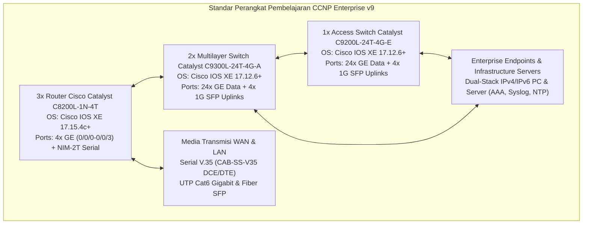
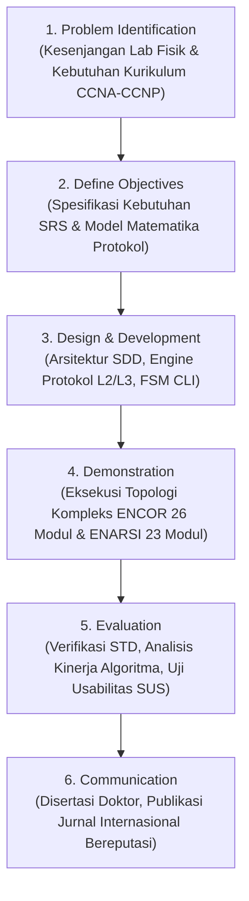
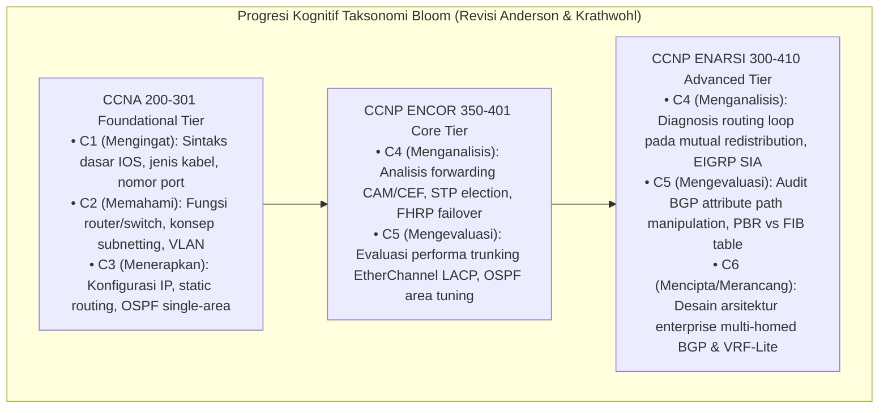

# DOKUMEN METODOLOGI PENELITIAN & SIKLUS HIDUP PENGEMBANGAN SISTEM (SDLC)
## Pengembangan Media Simulasi Jaringan Interaktif Berorientasi Standar Kompetensi Cisco CCNA 200-301 (v1.1) & CCNP Enterprise v9 (ENCOR 350-401 v1.2 & ENARSI 300-410 v1.1)

---

### Informasi Dokumen
- **Judul Proyek**: Cisco NetSim Pro (Enterprise Multi-Tier Cisco Network Simulator & Auto-Grader)
- **Kategori**: Educational Technology / Computer Science / Enterprise Network Engineering
- **Pendekatan Metodologi**: *Design Science Research Methodology (DSRM)* dikombinasikan dengan *Dual-V Model* Rekayasa Perangkat Lunak, *Agile Evolutionary Prototyping*, dan Model Desain Instruksional *ADDIE* (Analysis, Design, Development, Implementation, Evaluation)
- **Tujuan Dokumen**: Dokumen formal metodologis dan arsitektural untuk penelitian tingkat doktoral (Ph.D. Dissertation) serta penulisan artikel ilmiah pada jurnal internasional bereputasi (IEEE Transactions / Scopus Q1).

---

## 1. Latar Belakang & Landasan Filosofis Penelitian

Dalam pendidikan teknik komputer dan rekayasa jaringan enterprise (*Enterprise Computer Network Engineering*), penguasaan keterampilan praktis konfigurasi perangkat Cisco IOS / IOS-XE (*Internetwork Operating System*) merupakan kompetensi esensial yang dipersyaratkan oleh industri global. Kualifikasi profesional ini diukur secara formal melalui jenjang sertifikasi industri Cisco:
1. **Tingkat Asosiat (Associate)**: **Cisco Certified Network Associate (CCNA 200-301 v1.1)** — Fondasi switching L2, routing IPv4/IPv6, dan layanan IP dasar.
2. **Tingkat Profesional Enterprise (Professional)**:
   - **CCNP Enterprise: Core Networking (ENCOR 350-401 v1.2)** — Fondasi enterprise switching (CAM/TCAM, CEF, MSTP), High Availability (FHRP HSRP/VRRP/GLBP), L3 routing enterprise (OSPFv2/v3, EIGRP, BGP), QoS, virtualisasi (GRE, IPsec), dan keamanan kontrol plane (CoPP).
   - **CCNP Enterprise: Advanced Routing and Services (ENARSI 300-410 v1.1)** — Routing tingkat lanjut (EIGRP Named Mode & DUAL Wide Metrics, OSPF Multi-Area Stub/NSSA/Virtual Links, Mutual Route Redistribution dengan Route-Maps & Prefix-Lists, Path Control PBR & IP SLA, Enterprise BGP 13-Step Best Path & Route Reflectors, VRF-Lite, serta MPLS Layer 3 VPN).

Namun, institusi pendidikan tinggi dan pusat pelatihan kejuruan sering menghadapi kendala signifikan:
1. **Biaya Infrastruktur Hardware Riil yang Sangat Tinggi (*Prohibitive CapEx*)**: Pengadaan rak laboratorium enterprise fisik yang disyaratkan kurikulum resmi CCNP v9 — minimal 3 unit Router Cisco Catalyst C8200L-1N-4T dengan modul serial NIM-2T, 2 unit Multilayer Switch Cisco Catalyst C9300L-24T-4G-A, dan 1 unit Switch L2 Cisco Catalyst C9200L-24T-4G-E — memerlukan investasi puluhan ribu dolar AS serta biaya perawatan perangkat yang rentan rusak akibat siklus pakai (*hardware wear and tear*).
2. **Keterbatasan Emulator Berat (GNS3 / EVE-NG / CML)**: Membutuhkan komputer berspesifikasi server (RAM >32GB, CPU multicore dengan nested hardware virtualization KVM/QEMU), instalasi sistem operasi yang rumit, serta lisensi binary image Cisco IOS-XE berpemilik (*proprietary copyright*).
3. **Ketiadaan Simulator Ringan dengan Standar Kurikulum Lengkap**: Simulator komersial yang ada tidak menyediakan modul pembelajaran terpandu dengan evaluasi otomatis (*instant formative feedback*) yang mencakup seluruh spektrum silabus CCNA 200-301 hingga CCNP Enterprise v9 secara berjenjang.

Penelitian rekayasa ini membangun artefak perangkat lunak **"Cisco NetSim Pro"**, media simulasi jaringan deterministik berbasis web murni (*zero-install client*) yang mengemulasikan Cisco IOS & IOS-XE CLI, protokol L2/L3 enterprise, inspeksi perjalanan PDU 7-Layer OSI, dan mesin penilaian otomatis (*Automated Lab Grading & Exam Engine*).

---

## 2. Spesifikasi Perangkat Keras & Sistem Operasi Simulator CCNP Enterprise v9

Mengacu langsung pada silabus resmi *Cisco Networking Academy CCNP Enterprise v9 Equipment List*, sistem simulator mengadopsi spesifikasi perangkat keras dan versi sistem operasi berikut:

1. **Router Cisco Catalyst C8200L-1N-4T**:
   - Sistem Operasi: **Cisco IOS XE Version 17.15.4c** atau lebih tinggi.
   - Antarmuka Bawaan: 4 port GigabitEthernet terintegrasi (`GigabitEthernet0/0/0` s.d. `0/0/3`).
   - Slot Ekspansi WAN: Modul NIM-2T (*2-Port Serial WAN Interface Module*) dengan antarmuka `Serial0/1/0` dan `Serial0/1/1` berkemampuan clock rate sinkron (DCE) dan transmisi serial (DTE).
   - Fitur Utama: EIGRP Named Mode, Multi-Area OSPF, BGP-4 & MP-BGP, PBR, IP SLA, GRE Tunnels, VRF-Lite, CoPP, dan ZBFW/ACL.
2. **Multilayer Switch Cisco Catalyst C9300L-24T-4G-A**:
   - Sistem Operasi: **Cisco IOS XE Version 17.12.6** atau lebih tinggi.
   - Antarmuka: 24 port 10/100/1000 GigabitEthernet + 4 port 1G SFP Uplinks.
   - Fitur Utama: Inter-VLAN Routing via SVI, Routed Ports (`no switchport`), LACP/PAgP EtherChannel, FHRP (HSRPv1/v2, VRRPv2/v3), Spanning Tree (MSTP/Rapid-PVST+), Dynamic ARP Inspection, DHCP Snooping.
3. **Layer 2 Switch Cisco Catalyst C9200L-24T-4G-E**:
   - Sistem Operasi: **Cisco IOS XE Version 17.12.6** atau lebih tinggi.
   - Antarmuka: 24 port 10/100/1000 GigabitEthernet + 4 port 1G SFP Uplinks.
   - Fitur Utama: 802.1Q Trunking, Port-Channel (LACP), Port Security, VLAN Segmentation, STP Root Guard & BPDU Guard.
4. **End Hosts & Infrastructure Servers**:
   - Workstation PC: Dual-Stack IPv4/IPv6, Static & DHCP client, Visual Network Configuration GUI, Command Prompt (`ping`, `traceroute`, `arp -a`, `ipconfig /all`).
   - Enterprise Network Servers: DHCP Server, DNS, Syslog, NTP Server, dan simulasi server AAA (TACACS+/RADIUS).

---

## 3. Kerangka Kerja Metodologi: Design Science Research (DSRM)

Pengembangan sistem memadukan metodologi DSRM (*Peffers et al., 2007*) dengan siklus pengujian verifikasi formal *Dual-V Model*:

### 3.1 Tahap 1: Problem Identification and Motivation
- Menganalisis batasan simulator yang ada yang hanya berhenti pada level pemula (CCNA) dan tidak mampu mengakomodasi skenario routing enterprise kompleks seperti EIGRP DUAL *Feasible Successor*, redistribusi rute timbal-balik dengan *route-tagging*, penentuan jalur terbaik BGP 13-atribut, *Policy-Based Routing* terintegrasi IP SLA, dan isolasi *VRF-Lite*.

### 3.2 Tahap 2: Define Objectives of a Solution
- Merumuskan tujuan rekayasa sistem:
  - Mengembangkan parser CLI Cisco IOS-XE dengan fidelitas tinggi yang mendukung mode navigasi enterprise (`router eigrp <name>`, `router bgp <as>`, `route-map`, `ip prefix-list`, `track ip sla`).
  - Membangun *kernel deterministic simulation* yang akurat secara matematis untuk algoritma SPF Dijkstra OSPF, kalkulasi metrik komposit DUAL EIGRP, dan pohon keputusan seleksi BGP.
  - Membangun emulasi perangkat keras lengkap: Router C8200L (IOS XE 17.15.4c), Multilayer Switch C9300L (IOS XE 17.12.6), Switch L2 C9200L, antarmuka serial NIM-2T, dan PC/Server dual-stack.
  - Menyediakan visualisasi inspeksi paket OSI 7-Layer per hop dan mesin penilaian otomatis (*Auto-Grader*) dengan aturan kelulusan ketat (*Strict 100% Mastery Rule*).

### 3.3 Tahap 3: Design and Development
- Merancang arsitektur perangkat lunak berbasis komponen reaktif (TypeScript, React, Zustand), memodelkan state machine protokol secara deterministik, dan mengimplementasikan algoritma routing/switching.

### 3.4 Tahap 4: Demonstration
- Menguji simulator pada skenario praktikum representatif yang mencakup 6 domain CCNA 200-301, 26 modul ENCOR 350-401, dan 23 modul ENARSI 300-410.

### 3.5 Tahap 5: Evaluation
- Menguji ketepatan fungsional (*functional correctness*), benchmarking latensi komputasi rute, konsumsi memori, serta evaluasi pedagogis melalui *Pre-test/Post-test Control Group Design* dan instrumen *System Usability Scale (SUS)*.

### 3.6 Tahap 6: Communication
- Publikasi hasil rancang bangun, model matematika, dan temuan empiris dalam naskah disertasi doktor serta artikel ilmiah pada jurnal internasional bereputasi.

---

## 4. Landasan Teori Pedagogis & Scaffolding Kognitif

Pengembangan simulator ini mengintegrasikan teori pembelajaran modern untuk mendukung progresi kompetensi dari pemula hingga mahir:

1. **Kolb's Experiential Learning Theory (ELT)**:
   - *Concrete Experience*: Siswa mengonfigurasi perangkat simulasi secara interaktif via visual topology canvas dan CLI IOS-XE.
   - *Reflective Observation*: Siswa mengamati perjalanan paket, de-enkapsulasi PDU 7-Layer OSI, dan respon real-time protokol.
   - *Abstract Conceptualization*: Menghubungkan respon perintah `show` (seperti `show ip route`, `show ip eigrp topology`, `show ip bgp`) dengan teori algoritma graf dan protokol perutean.
   - *Active Experimentation*: Menyelesaikan tantangan skenario *troubleshooting* multi-protokol pada topologi enterprise kompleks.

2. **Cognitive Load Theory (Sweller, 1988)**:
   - *Extraneous Load Reduction*: Mengeliminasi beban teknis non-instruksional (seperti instalasi hypervisor, setup binary image IOS berbayar, atau konfigurasi GNS3 yang rawan gagal) melalui arsitektur web siap pakai (*zero setup*).
   - *Germane Load Optimization*: Memaksimalkan fokus mental siswa pada pemecahan masalah jaringan (*schema acquisition*) melalui umpan balik instan (*automated formative feedback*) dari modul Auto-Grader.

---

## 5. Matriks Siklus Hidup Pengembangan (SDLC Matrix)

| Fase SDLC | Standar Acuan | Dokumen Artefak | Luaran Ilmiah & Teknis |
| :--- | :--- | :--- | :--- |
| **1. Analisis Kebutuhan** | IEEE Std 830-1998 / ISO/IEC 29148 | `02_REQUIREMENTS_SPECIFICATION_SRS.md` | Matriks Pemetaan Kurikulum CCNA 200-301, CCNP ENCOR 350-401, dan CCNP ENARSI 300-410; Spesifikasi Perangkat C8200L, C9300L, C9200L, NIM-2T; Kebutuhan Fungsional FR-01 s.d. FR-36. |
| **2. Perancangan Sistem** | IEEE Std 1016-2009 (SDD) | `03_SYSTEM_ARCHITECTURE_AND_DESIGN_SDD.md` | Arsitektur Berlapis, Dekomposisi Engine Protokol (EIGRP, OSPF, BGP, Redistribution, VRF, CEF), FSM Parser IOS-XE, Diagram Kelas UML, Diagram Sekuens Paket. |
| **3. Algoritma & Model Matematika** | Formulasi Formal & Teori Graf | `04_ALGORITHMS_AND_MATHEMATICAL_FORMULATIONS.md` | Formulasi Metrik Komposit EIGRP (Classic & Wide Metrics), Kondisi Kelayakan DUAL ($RD < FD$), Pohon Keputusan Seleksi Jalur Terbaik BGP (13 Langkah), Algoritma SPF Dijkstra, Analisis Graf Pencegahan Loop Redistribusi Rute, Formulasi FHRP. |
| **4. Verifikasi & Pengujian** | IEEE Std 829-2008 (STD) | `05_VERIFICATION_VALIDATION_AND_TESTING_STD.md` | Matriks Kasus Uji Komprehensif (TC-CLI, TC-L2, TC-L3, TC-ENCOR-FHRP, TC-ENCOR-LACP, TC-ENARSI-EIGRP, TC-ENARSI-OSPF, TC-ENARSI-REDIST, TC-ENARSI-BGP, TC-ENARSI-VRF, TC-ENARSI-PBR), Benchmark Latensi & Memori. |
| **5. Evaluasi Ilmiah & Rubrik Pedagogis** | SUS (Brooke, 1996) & Taksonomi Bloom C1–C6 | `06_SCIENTIFIC_EVALUATION_AND_PEDAGOGICAL_RUBRICS.md` | Desain Eksperimen Kuasi (Nonequivalent Control Group), Uji Hipotesis Normalized Gain $\langle g \rangle$, Kuesioner SUS 10-Item, Rubrik Penilaian Bertingkat CCNA hingga CCNP Enterprise untuk Disertasi Doktor. |
