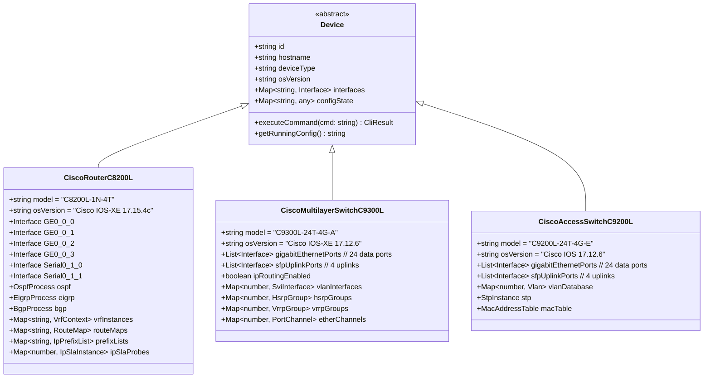

# SPESIFIKASI KEBUTUHAN PERANGKAT LUNAK (SRS)
## Berdasarkan Standar IEEE Std 830-1998 / ISO/IEC/IEEE 29148
### Proyek: Cisco NetSim Pro - Enterprise Multi-Tier Cisco Network Simulator & Auto-Grader
#### Cakupan: Cisco CCNA 200-301 (v1.1) & CCNP Enterprise v9 (ENCOR 350-401 v1.2 & ENARSI 300-410 v1.1)

---

## 1. Pendahuluan

### 1.1 Tujuan Dokumen
Dokumen Spesifikasi Kebutuhan Perangkat Lunak (*Software Requirements Specification* - SRS) ini mendefinisikan kebutuhan fungsional, kebutuhan non-fungsional, batasan arsitektural, dan spesifikasi perangkat simulator untuk sistem **Cisco NetSim Pro**. Dokumen ini dirancang sebagai acuan formal untuk rekayasa perangkat lunak, pengujian verifikasi, dan landasan empiris dalam penulisan disertasi doktor serta artikel ilmiah pada jurnal internasional bereputasi.

### 1.2 Cakupan Produk
Cisco NetSim Pro adalah media simulasi jaringan deterministik berbasis web yang meniru perilaku fisik dan operasional perangkat jaringan Cisco enterprise:
- **Router Cisco Catalyst C8200L-1N-4T** (Cisco IOS XE 17.15.4c+) dengan modul Serial NIM-2T.
- **Multilayer Switch Cisco Catalyst C9300L-24T-4G-A** (Cisco IOS XE 17.12.6+).
- **Access Switch Cisco Catalyst C9200L-24T-4G-E** (Cisco IOS XE 17.12.6+).
- **Enterprise Endpoints & Infrastructure Servers** (Dual-Stack IPv4/IPv6 PC, AAA, DNS, Syslog, NTP).

Sistem dilengkapi parser antarmuka baris perintah (*Command Line Interface* - CLI) Cisco IOS & IOS-XE yang autentik, visualisasi aliran paket per lapisan model OSI 7-Layer, dan mesin penilaian otomatis (*Automated Lab Grading & Exam Engine*).

---

## 2. Pemetaan Terhadap Kurikulum Cisco CCNA 200-301 & CCNP Enterprise v9

Sistem dirancang untuk mencakup seluruh pilar kompetensi dari jenjang Associate (CCNA) hingga Enterprise Professional (CCNP):

### 2.1 Pemetaan Blueprint CCNA 200-301 (v1.1)
| Domain CCNA | Bobot | Topik Spesifik yang Disimulasikan | Modul Sistem Terkait |
| :--- | :---: | :--- | :--- |
| **1. Network Fundamentals** | 20% | Peran router/switch, pengkabelan (copper, fiber), subnetting IPv4/IPv6 (FLSM/VLSM), endpoint IP. | Canvas Designer, Subnet Engine, Host Model |
| **2. Network Access** | 20% | VLAN (normal, voice, native), 802.1Q trunking, Spanning Tree (STP/RSTP), EtherChannel (LACP), Port Security. | Switch L2/L3 Engine, STP Solver, Trunk Evaluator |
| **3. IP Connectivity** | 25% | Tabel routing (LPM), Static Routing, Default Route, OSPFv2 Single-Area (Router-ID, cost, passive interface). | Routing Engine, OSPF FSM, SPF Shortest Path |
| **4. IP Services** | 10% | DHCP Server & Relay (`ip helper-address`), DNS, NAT/PAT, Standard & Extended IPv4 ACLs, CDP, ARP. | Network Services Manager, ACL Engine, NAT/ARP/CDP |
| **5. Security Fundamentals** | 15% | Password encryption, console/VTY security, enable secret, banner MOTD, sticky MAC, SSH. | Device Security Manager, AAA/VTY Validator |
| **6. Automation & Programmability** | 10% | Konsep REST API, payload JSON, arsitektur controller (Catalyst Center API endpoints). | Automation Sandbox, JSON Inspector |

### 2.2 Pemetaan Kurikulum CCNP Enterprise: Core Networking (ENCOR 350-401 v1.2 — 26 Modul)
| Domain ENCOR | Modul Silabus Terkait | Topik Inti yang Disimulasikan |
| :--- | :--- | :--- |
| **Forwarding & L2 Architecture** | Modul 1, 2, 3, 4 | Packet Forwarding (CAM, TCAM, CEF FIB/Adjacency), Spanning Tree (MSTP 802.1s, Rapid-PVST+), Dynamic EtherChannel (LACP 802.3ad, PAgP). |
| **Enterprise Routing** | Modul 5, 6, 7, 8, 9 | Inter-VLAN Routing (SVI & Routed Ports), EIGRP Fundamentals, OSPFv2 & OSPFv3 Multi-Area, Advanced OSPF Tuning, EBGP Fundamentals. |
| **High Availability & Services** | Modul 10, 11, 14, 15 | First Hop Redundancy Protocols (HSRPv1/v2, VRRPv2/v3, GLBP), IP Services (NTP, SNMPv3, Syslog), Multicast Concepts (PIM, IGMP). |
| **Enterprise Security & Overlays**| Modul 17, 18, 19, 20, 21 | Control Plane Policing (CoPP), ACLs, AAA (TACACS+/RADIUS), GRE Point-to-Point Tunneling, IPsec Site-to-Site VPN Concepts. |
| **SDN & Automation** | Modul 24, 25, 26 | Cisco Catalyst Center (DNA Center) Architecture, RESTCONF, NETCONF, YANG data models, Python Network Automation. |

### 2.3 Pemetaan Kurikulum CCNP Enterprise: Advanced Routing and Services (ENARSI 300-410 v1.1 — 23 Modul)
| Domain ENARSI | Modul Silabus Terkait | Topik Inti yang Disimulasikan |
| :--- | :--- | :--- |
| **Advanced IPv4/IPv6 Routing** | Modul 1, 2, 3, 4 | IPv4/IPv6 Supernetting & Summarization, Advanced Distance Vector, EIGRP Classic Mode & EIGRP Named Mode. |
| **Advanced EIGRP Engine** | Modul 5, 6, 7, 8 | EIGRP Wide Metrics (64-bit), DUAL Feasibility Condition ($RD < FD$), Feasible Successors, EIGRP Stubs, SIA mitigation, Summary Routes. |
| **Advanced Multi-Area OSPF** | Modul 9, 10, 11 | Link-State Database (LSDB) Sync, LSA Types 1–5 & 7, Special Area Types (Stub, Totally Stubby, NSSA, Totally NSSA), Virtual Links. |
| **Route Manipulation & Redist.**| Modul 12, 13, 14 | Mutual Route Redistribution (OSPF $\leftrightarrow$ EIGRP $\leftrightarrow$ BGP), Route-Maps, Prefix-Lists, Distribute-Lists, Route Tagging loop prevention. |
| **Path Control & IP SLA** | Modul 15 | Policy-Based Routing (PBR) dengan `match ip address` dan `set ip next-hop`, pemantauan status objek melalui IP SLA tracking. |
| **Enterprise BGP Engine** | Modul 16, 17, 18, 19 | BGP FSM, IBGP vs EBGP, BGP 13-Step Best Path Algorithm, Route Reflectors, Peer Groups, MP-BGP (IPv4 & IPv6 Address Families). |
| **MPLS & VRF Virtualization** | Modul 20, 21 | VRF-Lite (Multi-VRF table isolation per interface), Arsitektur MPLS L3 VPN, LDP label distribution, LIB, LFIB packet forwarding. |
| **Infrastructure Security & Mgmt**| Modul 22, 23 | Router Hardening, uRPF (Unicast Reverse Path Forwarding), IPv6 First-Hop Security (RA Guard, ND Inspection), NetFlow/IPFIX. |

---

## 3. Spesifikasi Perangkat Keras Simulator (CCNP Simulator Device Baseline)

Untuk memenuhi kebutuhan praktikum dan penelitian sesuai standar resmi Cisco CCNP Enterprise v9, simulator menyediakan profil perangkat keras berikut:

1. **Router Cisco Catalyst C8200L-1N-4T**:
   - Model Hardware: Cisco Catalyst 8200 Edge-L Platforms with 1 NIM slot and 4 1-Gigabit onboard Ethernet ports.
   - Versi Sistem Operasi: **Cisco IOS XE Version 17.15.4c** atau lebih tinggi.
   - Nomenklatur Port:
     - `GigabitEthernet0/0/0` s.d. `GigabitEthernet0/0/3` (Copper 10/100/1000 Mbps).
     - `Serial0/1/0` dan `Serial0/1/1` (NIM-2T WAN Serial module dengan dukungan enkapsulasi HDLC/PPP, parameter `clock rate`, dan kabel V.35 DCE/DTE).
     - Antarmuka logis: `Loopback<id>`, `Tunnel<id>` (GRE), dan Sub-interfaces `GigabitEthernet0/0/x.y` (802.1Q).
   - Layanan Inti: IPv4/IPv6 Dual-Stack Routing, EIGRP Named/Classic, Multi-Area OSPFv2/v3, BGP-4/MP-BGP, Mutual Redistribution, Route-Maps, Prefix-Lists, PBR, IP SLA Object Tracking, VRF-Lite, GRE Tunneling, CoPP, uRPF, DHCP Server/Relay, NAT/PAT.

2. **Multilayer Switch Cisco Catalyst C9300L-24T-4G-A**:
   - Model Hardware: Cisco Catalyst 9300L Switch 24-port Data, 4x 1G Uplink.
   - Versi Sistem Operasi: **Cisco IOS XE Version 17.12.6** atau lebih tinggi.
   - Nomenklatur Port:
     - `GigabitEthernet1/0/1` s.d. `GigabitEthernet1/0/24` (Data Ports).
     - `GigabitEthernet1/1/1` s.d. `GigabitEthernet1/1/4` (SFP Uplink Ports).
     - Switched Virtual Interfaces: `Vlan<id>`.
     - Port-Channel: `Port-channel<id>`.
   - Layanan Inti: IP Routing (`ip routing`), Inter-VLAN Routing via SVI, Routed Ports (`no switchport`), EtherChannel (LACP 802.3ad & PAgP), FHRP (HSRPv1/v2, VRRPv2/v3, GLBP), MSTP (802.1s), Rapid-PVST+, Dynamic ARP Inspection, DHCP Snooping.

3. **Access Switch Cisco Catalyst C9200L-24T-4G-E**:
   - Model Hardware: Cisco Catalyst 9200L Switch 24-port Data, 4x 1G Uplink.
   - Versi Sistem Operasi: **Cisco IOS XE / IOS Version 17.12.6** atau lebih tinggi.
   - Nomenklatur Port:
     - `GigabitEthernet1/0/1` s.d. `GigabitEthernet1/0/24`.
     - `GigabitEthernet1/1/1` s.d. `GigabitEthernet1/1/4`.
   - Layanan Inti: 802.1Q VLAN Trunking, Access VLANs, Spanning Tree (PVST+, Rapid-PVST+, MSTP), Port Security (Sticky MAC), LACP EtherChannel, BPDU Guard, Root Guard.

4. **Enterprise Host & Infrastructure Endpoints**:
   - PC / Workstation: Pengalamatan Dual-Stack IPv4 & IPv6, Static vs DHCP/SLAAC, Visual GUI Network Dialog, Command Prompt (`ping`, `traceroute`, `arp -a`, `netstat`, `ipconfig /all`).
   - Enterprise Servers: Simulasi Server DHCP, Server DNS, Server Syslog, Server NTP, dan Server Autentikasi AAA (TACACS+/RADIUS).

---

## 4. Kebutuhan Fungsional Sistem (Functional Requirements)

### 4.1 Kebutuhan Fungsional Fondasi (FR-01 s.d. FR-24 — Kompatibilitas CCNA 200-301)
| Kode FR | Nama Fitur | Deskripsi Kebutuhan Fungsional |
| :--- | :--- | :--- |
| **FR-01** | Visual Canvas Topology | Kanvas interaktif drag-and-drop untuk menempatkan Router C8200L, Switch C9300L/C9200L, PC, dan Server dengan koordinat bebas. |
| **FR-02** | Cable & Port Interconnection | Penghubungan kabel Straight-Through, Crossover, Fiber SFP, dan Serial V.35 (DCE/DTE) dengan status operasional antarmuka (Up/Down). |
| **FR-03** | Cisco IOS Multi-Mode CLI | Parser hierarki CLI: User Exec (`>`), Privileged Exec (`#`), Global Config (`(config)#`), Interface Config (`(config-if)#`), Sub-interface (`(config-subif)#`), VLAN (`(config-vlan)#`), Router Config (`(config-router)#`), dan Line (`(config-line)#`). |
| **FR-04** | Contextual Help & Tab Completion | Tombol `?` untuk daftar perintah kontekstual dan `Tab` untuk melengkapi kata kunci perintah. |
| **FR-05** | Abbreviated Command Support | Dukungan singkatan perintah standar Cisco IOS (seperti `sh ip int br`, `conf t`, `no shut`, `wr mem`, `int g0/0/0`). |
| **FR-06** | Running-Config Generation | Pembangkitan teks `show running-config` secara dinamis dan akurat dari state konfigurasi aktif. |
| **FR-07** | Layer 2 Switching Simulation | Pembelajaran tabel MAC (*MAC learning*), broadcast segmentation per VLAN, dan penerusan 802.1Q trunk. |
| **FR-08** | Inter-VLAN Routing Simulation | Router-on-a-Stick via sub-interfaces 802.1Q dan Switch Virtual Interface (SVI) pada L3 Switch. |
| **FR-09** | Layer 3 Routing & OSPFv2 Single Area | Tabel routing Longest Prefix Match (LPM) dan kalkulasi rute OSPFv2 Area 0 berbasis SPF Dijkstra. |
| **FR-10** | IP Services Simulation | DHCP Server/Relay (`ip helper-address`), NAT/PAT overload, dan Standard/Extended IPv4 ACL. |
| **FR-11** | Dual Mode: Real-time & Simulation | Mode Real-time untuk eksekusi langsung dan mode Simulation untuk inspeksi langkah-demi-langkah perjalanan paket. |
| **FR-12** | OSI 7-Layer PDU Inspector | Visualisasi header L2 MAC, L3 IP, dan L4 ICMP/TCP/UDP dengan pemisahan In-Layers dan Out-Layers. |
| **FR-13** | Lab Curriculum Modules | Modul praktikum terintegrasi dengan topologi otomatis, skenario tugas, dan petunjuk langkah-demi-langkah. |
| **FR-14** | Automated Lab Grading Engine | Mesin asesmen otomatis ("Check Lab") yang mengaudit kepatuhan konfigurasi dan konektivitas data-plane (0-100%). |
| **FR-15** | Topology Persistence & Export | Penyimpanan dan pembukaan file topologi format `.json`. |
| **FR-16** | Strict Mastery Grading Rule | Praktikan dinyatakan LULUS (*PASS*) hanya jika skor mencapai tepat 100% (*perfect mastery*). |
| **FR-17** | Visual Host IP & Gateway GUI | Dialog grafis untuk mengatur IPv4/IPv6, Subnet Mask, Gateway, DNS, dan mode Static/DHCP pada PC tanpa CLI. |
| **FR-18** | Free Sandbox Mode | Mode kanvas kosong bersih (*zero-state*) untuk perancangan topologi bebas dari nol. |
| **FR-19** | Live Physical Device Connector | Jembatan ke antarmuka fisik lokal (Host NIC Bridging), direct SSH/Telnet ke hardware, dan live ICMP probe. |
| **FR-20** | Pearson VUE CCNA Exam Engine | Simulator ujian resmi dengan timer 120 menit, Multiple Choice, Drag-and-Drop graf bipartit, dan Simlet CLI interaktif. |
| **FR-21** | Command History Navigation | Navigasi riwayat perintah menggunakan panah atas/bawah (`ArrowUp`/`ArrowDown`) dan shortcut Emacs (`Ctrl+P`/`Ctrl+N`), preservasi draf pengetikan, dan kursor otomatis di akhir baris (*retyping*). |
| **FR-22** | Cisco Discovery Protocol (CDP) | Simulasi penuh CDP v2 global (`cdp run`, `cdp timer/holdtime`), antarmuka (`cdp enable`), dan verifikasi (`show cdp neighbors [detail]`). |
| **FR-23** | Layer 3 Switch Cisco IOS-XE 17.12.6+ | Emulasi Multilayer Switch Catalyst 9300L dengan image Cisco IOS-XE 17.12.6, SVI, routed ports (`no switchport`), dan routing LPM. |
| **FR-24** | Address Resolution Protocol (ARP) Suite | Simulasi ARP dua arah di semua perangkat (Router, L2/L3 Switch, PC, Server): `show ip arp`, `clear ip arp`, entri statis, dan Host `arp -a`, `arp -s`, `arp -d`. |

---

### 4.2 Kebutuhan Fungsional Tingkat Lanjut (FR-25 s.d. FR-36 — Spesifikasi CCNP Enterprise v9)
| Kode FR | Nama Fitur | Deskripsi Kebutuhan Fungsional |
| :--- | :--- | :--- |
| **FR-25** | Advanced Multi-Area OSPF | Sistem mendukung pembentukan topologi Multi-Area OSPF dengan LSA Tipe 1 (Router), Tipe 2 (Network), Tipe 3 (Summary), Tipe 4 (ASBR Summary), Tipe 5 (AS External), dan Tipe 7 (NSSA External). Mendukung konfigurasi Area Khusus: **Stub**, **Totally Stubby** (`no-summary`), **NSSA**, dan **Totally NSSA**, translasi LSA 7-ke-5 pada ABR/ASBR, rute summarization (`area <id> range`), serta **OSPF Virtual Links** untuk menghubungkan area terisolasi ke Area 0. |
| **FR-26** | Advanced EIGRP Engine | Sistem mendukung protokol EIGRP dalam dua model konfigurasi: **Classic Mode** (`router eigrp <asn>`) dan **Named Mode** (`router eigrp <name>` $\rightarrow$ `address-family ipv4`). Sistem mengimplementasikan algoritma DUAL untuk menghitung *Feasible Distance* (FD), *Reported Distance* (RD), pemilihan *Successor* dan *Feasible Successor* ($RD < FD$), bobot metrik komposit ($K_1$ s.d. $K_5$), *Wide Metrics* (skala 64-bit), EIGRP Stub Routers (`eigrp stub connected summary`), serta mitigasi kondisi *Stuck-in-Active* (SIA). |
| **FR-27** | Enterprise BGP Engine | Sistem mengimplementasikan protokol Border Gateway Protocol (BGP-4) dengan mesin keadaan berhingga (BGP FSM: Idle, Connect, Active, OpenSent, OpenConfirm, Established). Mendukung peering internal (IBGP) dan eksternal (EBGP), konfigurasi `neighbor <ip> remote-as <asn>`, `update-source Loopback`, `next-hop-self`, **BGP 13-Step Best Path Algorithm**, manipulasi atribut rute (Weight, Local Preference, AS-Path Prepending, MED), BGP Peer Groups, dan **BGP Route Reflectors** (`neighbor <ip> route-reflector-client`). |
| **FR-28** | Mutual Route Redistribution & Policy Filtering | Sistem mendukung pertukaran rute timbal-balik antar domain perutean berbeda (OSPF $\leftrightarrow$ EIGRP $\leftrightarrow$ BGP $\leftrightarrow$ Static $\leftrightarrow$ Connected). Mendukung sintaks redistribusi dengan parameter metrik (`redistribute <proto> metric <val> subnets`), konfigurasi kebijakan rute berlapis menggunakan **Route-Maps** (`route-map <name> permit/deny <seq>`, `match ip address`, `match ip prefix-list`, `set metric`, `set route-tag`), **IP Prefix-Lists** (`ip prefix-list <name> seq <seq> permit/deny <net>/<len> [ge/le]`), dan mekanisme **Route Tagging** ($\tau$) untuk memutus siklus *routing feedback loop*. |
| **FR-29** | Policy-Based Routing (PBR) & IP SLA | Sistem mendukung pengalihan jalur paket berdasarkan kebijakan administrator melalui Route-Map yang diterapkan pada antarmuka masuk (`ip policy route-map <name>`). Mendukung klausa `match ip address <acl>` dan `set ip next-hop <ip>`. Sistem mengintegrasikan mekanisme **IP SLA Object Tracking** (`ip sla <id>`, `icmp-echo <target>`, `track <id> ip sla <id> state`) di mana next-hop PBR hanya aktif jika probe IP SLA berstatus reachable; jika probe gagal, paket otomatis beralih ke jalur cadangan atau kembali ke tabel routing standar. |
| **FR-30** | First-Hop Redundancy Protocols (FHRP) | Sistem mengemulasikan redundansi gateway bawaan menggunakan **HSRPv1** (multicast `224.0.0.2`, MAC virtual `0000.0c07.acXX`), **HSRPv2** (multicast `224.0.0.102`, MAC virtual `0000.0c9f.fXXX`), dan **VRRPv2/v3** (multicast `224.0.0.18`, MAC virtual `0000.5e00.01XX`). Mendukung penetapan *priority*, *preemption* (`standby <group> preempt`), pelacakan status antarmuka (*interface tracking*), dan respon ARP virtual gateway otomatis. |
| **FR-31** | Advanced Layer 2 Switching & Dynamic EtherChannel | Sistem mendukung agregasi link fisik menjadi logical channel menggunakan protokol negosiasi standar IEEE **802.3ad LACP** (`channel-group <id> mode active/passive`) dan protokol kepemilikan Cisco **PAgP** (`channel-group <id> mode desirable/auto`). Sistem juga mendukung implementasi **Multiple Spanning Tree Protocol (MSTP 802.1s)** dengan instance pemetaan VLAN serta **Rapid-PVST+** untuk konvergensi instan topologi Layer 2. |
| **FR-32** | Virtual Routing and Forwarding (VRF-Lite) | Sistem mengimplementasikan isolasi tabel perutean ganda (*Multi-VRF*) pada perangkat Router dan Switch L3 tanpa memerlukan MPLS di core. Mendukung definisi VRF (`vrf definition <name>` atau `ip vrf <name>`), pemetaan antarmuka ke instans VRF (`vrf forwarding <name>`), serta isolasi menyeluruh tabel routing, tabel ARP, dan penerusan paket antar domain yang memiliki subnet IP bertumpukan (*overlapping IP subnets*). |
| **FR-33** | MPLS Forwarding Fundamentals | Sistem memodelkan fondasi arsitektur perutean berbasis label Multi-Protocol Label Switching (MPLS): pertukaran label via Label Distribution Protocol (LDP), pembentukan *Label Information Base* (LIB), pembangunan tabel penerusan *Label Forwarding Information Base* (LFIB), dan visualisasi operasi de/enkapsulasi header label (*Push*, *Pop*, *Swap*) pada inspektur PDU. |
| **FR-34** | Control Plane Security & Router Hardening | Sistem menyediakan mekanisme proteksi bidang kontrol perangkat melalui **Control Plane Policing (CoPP)** dengan kebijakan pembatasan laju (*rate-limiting*) trafik ICMP, Telnet, dan routing control plane. Sistem juga mendukung pengamanan verifikasi rute balik **Unicast Reverse Path Forwarding (uRPF)** dalam mode *Strict* dan *Loose* untuk mencegah pemalsuan IP (*IP spoofing*), serta simulasi autentikasi AAA (TACACS+/RADIUS). |
| **FR-35** | Overlay & Tunneling Technologies (GRE & IPsec) | Sistem mengemulasikan antarmuka virtual **Generic Routing Encapsulation (GRE)** point-to-point (`interface Tunnel <id>`, `tunnel source`, `tunnel destination`, `tunnel mode gre ip`). Trafik data dan paket perutean dinamis (OSPF/EIGRP) dapat dienkapsulasi dan dialirkan melintasi jaringan WAN publik tanpa mengubah header asli, disertai pemodelan profil keamanan IPsec dasar. |
| **FR-36** | Cisco IOS-XE Enterprise CLI Parser Expansion | Sistem memperluas parser CLI untuk mengenali seluruh sintaks konfigurasi dan verifikasi CCNP Enterprise: mode EIGRP Named (`router eigrp <name>` $\rightarrow$ `address-family ipv4 autonomous-system <asn>`), mode BGP (`router bgp <asn>`), mode Route-Map (`route-map <name> permit <seq>`), mode IP SLA (`ip sla <id>`), konfigurasi FHRP (`standby <grp> ip <addr>`), perintah VRF (`ip vrf <name>`), serta seluruh perintah diagnostik `show` terkait (`show ip eigrp topology`, `show ip bgp summary`, `show ip ospf database`, `show standby brief`, `show vrf`). |

---

## 5. Kebutuhan Non-Fungsional (Non-Functional Requirements)

### 5.1 Kinerja (Performance)
- **NFR-P1 (CLI Input Latency)**: Waktu pemrosesan penekanan tombol dan eksekusi perintah terminal harus di bawah 50 milidetik (*sub-50ms latency*).
- **NFR-P2 (Enterprise Routing Calculation Latency)**: Waktu konvergensi algoritma Dijkstra SPF Multi-Area OSPF, DUAL EIGRP, dan BGP Best Path pada topologi s.d. 30 node harus selesai dalam waktu kurang dari 150 milidetik.
- **NFR-P3 (Memory Efficiency)**: Konsumsi memori peramban (*browser JavaScript heap*) tidak melebihi 200 MB, memungkinkan simulator berjalan mulus di laptop standar tanpa memerlukan server virtualisasi.
- **NFR-P4 (Web Initial Loading)**: Waktu pemuatan awal sistem di browser kurang dari 2.0 detik pada jaringan internet standar.

### 5.2 Keandalan & Determinisme (Reliability & Determinism)
- **NFR-R1 (Deterministic State Engine)**: Rangkaian konfigurasi yang identik wajib menghasilkan state jaringan, tabel routing RIB, tabel forwarding FIB, dan respon CLI yang konsisten 100% (*zero nondeterministic anomaly*).
- **NFR-R2 (State Persistence Integrity)**: Fungsi Simpan dan Buka topologi (`.json`) menjamin integritas konfigurasi tanpa ada parameter yang hilang (*zero data loss*).

### 5.3 Usabilitas (Usability)
- **NFR-U1 (Learnability & Industry Alignment)**: Antarmuka visual kanvas dan terminal mengikuti konvensi industri Cisco Packet Tracer dan Boson NetSim sehingga praktikan tidak membutuhkan adaptasi antarmuka yang membingungkan.
- **NFR-U2 (System Usability Scale Target)**: Ditargetkan mencapai skor pengujian SUS minimal > 82.5 (kategori *Grade A / Excellent*).

### 5.4 Kompatibilitas & Portabilitas (Compatibility & Portability)
- **NFR-C1 (Zero-Install Cross-Platform)**: Berjalan secara *native* pada seluruh peramban web modern (Google Chrome, Mozilla Firefox, Apple Safari, Microsoft Edge) di platform macOS, Linux, dan Windows.
- **NFR-C2 (Containerized Portability)**: Dilengkapi file Dockerfile dan Docker Compose untuk kemudahan instalasi di server lokal, lab kampus, maupun cloud.
