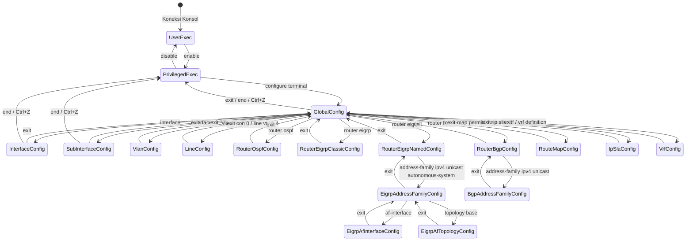
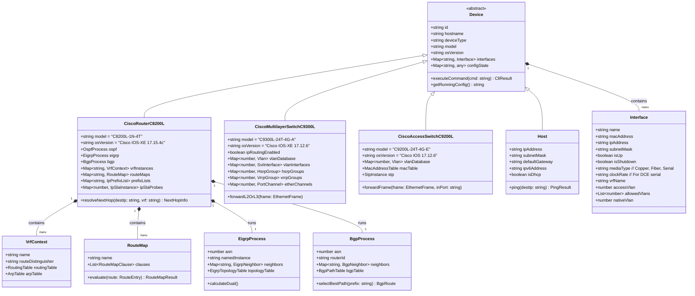
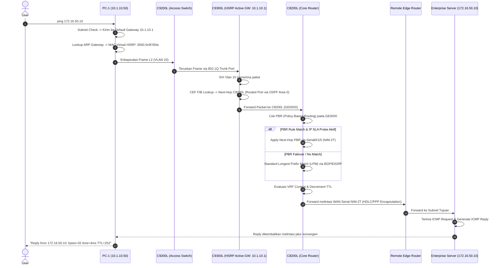
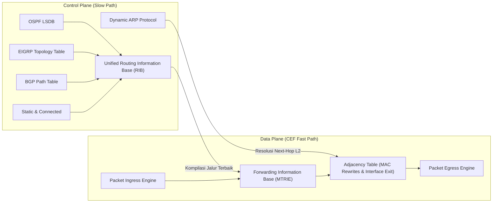

# DOKUMEN PERANCANGAN SISTEM (SOFTWARE DESIGN DOCUMENT - SDD)
## Berdasarkan Standar IEEE Std 1016-2009
### Proyek: Cisco NetSim Pro - Enterprise Multi-Tier Cisco Network Simulator & Auto-Grader
#### Cakupan: Cisco CCNA 200-301 (v1.1) & CCNP Enterprise v9 (ENCOR 350-401 v1.2 & ENARSI 300-410 v1.1)

---

## 1. Ikhtisar Arsitektur Sistem (System Architectural Overview)

Sistem **Cisco NetSim Pro** mengimplementasikan arsitektur modular berlapis (*Layered & Component-Based State Architecture*) yang memisahkan secara tegas antara lapisan visualisasi (*Presentation*), manajemen status aplikasi (*State Management*), bidang kontrol protokol (*Control Plane Engines*), bidang penerusan data (*Data Plane / Cisco Express Forwarding*), serta subsistem evaluasi pedagogis (*Auto-Grading & Exam Engine*).

```mermaid
graph TD
    subgraph UI_Layer["1. Presentation Layer (React 18 + Tailwind CSS + Canvas/SVG)"]
        TC[Interactive Topology Canvas]
        CT[Cisco IOS-XE Authentic Terminal Emulator]
        LP[Lab Curriculum & Scenario Panel]
        PI[OSI 7-Layer & PDU Inspector]
        GM[Auto-Grader Diagnostic Modal]
        EX[Pearson VUE Exam Simulator Engine]
    end

    subgraph State_Layer["2. Application State Management (Zustand 4.5)"]
        NS[Network Topology Store]
        TS[Terminal Session Store]
        SS[Simulation Event Queue Store]
        LS[Lab Progression & User Identity Store]
    end

    subgraph Control_Plane["3. Enterprise Control Plane Engines"]
        CLI[Cisco IOS-XE Parser & Lexer FSM]
        DEV[Device Models: C8200L, C9300L, C9200L, Host, Server]
        OSPF[OSPFv2/v3 Engine: LSDB, LSA 1-5 & 7, Stub/NSSA, Virtual Links]
        EIGRP[EIGRP Engine: Classic/Named Mode, DUAL FSM, Wide Metrics]
        BGP[BGP-4 Engine: FSM, 13-Step Best Path, Route Reflector]
        REDIST[Mutual Redistribution Engine: Route-Maps, Prefix-Lists, Tagging]
        FHRP[FHRP Engine: HSRPv1/v2, VRRPv2/v3, GLBP]
        PBR[PBR & IP SLA Tracking Engine]
        L2[L2 Protocols: VLAN 802.1Q, MSTP, LACP/PAgP, CDP, ARP]
        VRF[VRF Manager: Multi-VRF Context Isolation]
    end

    subgraph Data_Plane["4. Cisco Express Forwarding (CEF) Data Plane"]
        RIB[Unified Routing Information Base Manager]
        FIB[FIB Forwarding Engine (Longest Prefix Match Trie)]
        ADJ[Adjacency Table & ARP Resolution Cache]
        MPLS[MPLS Shim Label Push/Pop/Swap Engine]
    end

    subgraph Assessment_Subsystem["5. Pedagogical & Assessment Subsystem"]
        LG[Rule-Based Lab Grader (Strict 100% Mastery)]
        AST[Running-Config AST Auditor]
        PM[Data-Plane Reachability Ping Matrix]
    end

    UI_Layer <--> State_Layer
    State_Layer <--> Control_Plane
    Control_Plane --> RIB
    RIB --> FIB
    FIB <--> ADJ
    State_Layer <--> Assessment_Subsystem
    Assessment_Subsystem --> Data_Plane
```

---

## 2. Dekomposisi Subsistem Kontrol Plane & Parser Cisco IOS-XE CLI

### 2.1 Finite State Machine (FSM) Navigasi Mode CLI Cisco IOS-XE
Parser CLI mengimplementasikan mesin keadaan berhingga (*Finite State Machine*) berhierarki penuh yang mencakup seluruh mode konfigurasi enterprise CCNP:



### 2.2 Tabel Transisi Prompt CLI Cisco IOS-XE
| Mode CLI | Tampilan Prompt | Perintah Masuk Utama | Perintah Keluar |
| :--- | :--- | :--- | :--- |
| **User EXEC** | `Router>` | Inisialisasi sesi konsol | `exit` (disconnect) |
| **Privileged EXEC** | `Router#` | `enable` | `disable`, `exit` |
| **Global Configuration** | `Router(config)#` | `configure terminal` | `exit`, `end`, `Ctrl+Z` |
| **Interface Config** | `Router(config-if)#` | `interface GigabitEthernet0/0/0` | `exit`, `end` |
| **Serial WAN Config** | `Router(config-if)#` | `interface Serial0/1/0` | `exit`, `end` |
| **Sub-Interface Config** | `Router(config-subif)#` | `interface GigabitEthernet0/0/0.10` | `exit`, `end` |
| **VLAN Config** | `Switch(config-vlan)#` | `vlan 10` | `exit`, `end` |
| **SVI Config** | `Switch(config-if)#` | `interface Vlan10` | `exit`, `end` |
| **Router OSPF Config** | `Router(config-router)#` | `router ospf 1` | `exit`, `end` |
| **Router EIGRP Classic** | `Router(config-router)#` | `router eigrp 100` | `exit`, `end` |
| **Router EIGRP Named** | `Router(config-router)#` | `router eigrp ENTERPRISE` | `exit`, `end` |
| **EIGRP Address-Family** | `Router(config-router-af)#` | `address-family ipv4 unicast autonomous-system 100` | `exit`, `end` |
| **EIGRP AF-Interface** | `Router(config-router-af-interface)#` | `af-interface GigabitEthernet0/0/0` | `exit`, `end` |
| **EIGRP AF-Topology** | `Router(config-router-af-topology)#` | `topology base` | `exit`, `end` |
| **Router BGP Config** | `Router(config-router)#` | `router bgp 65001` | `exit`, `end` |
| **BGP Address-Family** | `Router(config-router-af)#` | `address-family ipv4` | `exit`, `end` |
| **Route-Map Config** | `Router(config-route-map)#` | `route-map POLICY_FILTER permit 10` | `exit`, `end` |
| **IP SLA Config** | `Router(config-ip-sla)#` | `ip sla 1` | `exit`, `end` |
| **VRF Definition Config**| `Router(config-vrf)#` | `vrf definition CUSTOMER_A` | `exit`, `end` |
| **Line Config** | `Router(config-line)#` | `line console 0` / `line vty 0 4` | `exit`, `end` |

---

## 3. Diagram Kelas Sistem Berorientasi Objek (UML Class Diagram)



---

## 4. Diagram Alur Transmisi Paket Multi-Hop Enterprise (Sequence Diagram)

Diagram berikut mengilustrasikan alur penerusan paket melintasi topologi enterprise lengkap:
Host $\rightarrow$ Access Switch C9200L $\rightarrow$ Multilayer Switch C9300L (HSRP Virtual Gateway) $\rightarrow$ Core Router C8200L (Evaluasi PBR & VRF) $\rightarrow$ WAN Link Serial NIM-2T $\rightarrow$ Remote Enterprise Server.



---

## 5. Arsitektur Cisco Express Forwarding (CEF) Data Plane

Untuk mencapai determinisme pemrosesan paket berkinerja tinggi, sistem memisahkan Control Plane dan Data Plane sesuai prinsip Cisco Express Forwarding (CEF):



1. **Forwarding Information Base (FIB)**: Struktur pohon prefix (*Multi-bit Radix Tree / Trie*) yang menyimpan salinan teroptimasi dari tabel routing RIB. Lookup alamat IP tujuan diselesaikan dalam waktu $O(k)$ di mana $k$ adalah panjang bit alamat IP ($k=32$ untuk IPv4).
2. **Adjacency Table**: Memetakan setiap entri next-hop langsung ke informasi header Layer 2 (MAC tujuan, MAC sumber antarmuka lokal, tag 802.1Q) tanpa memerlukan evaluasi ARP ulang untuk setiap paket.
3. **Pemisahan Konteks VRF**: Setiap instans VRF (`VrfContext`) memiliki pasangan FIB dan Adjacency Table terisolasi sendiri, mencegah kebocoran trafik (*route leaking*) kecuali jika dikonfigurasi secara eksplisit.

---

## 6. Subsistem Penilaian Otomatis & Ujian Pearson VUE

### 6.1 Arsitektur Penilaian Bertingkat (Tiered Auto-Grader)
Mesin penilai otomatis (*Lab Auto-Grader*) mengevaluasi keberhasilan praktikum secara berjenjang:
1. **Audit AST Konfigurasi Aktif (*Abstract Syntax Tree Verification*)**: Memeriksa keberadaan baris perintah deklaratif wajib (misal: `router eigrp <name>`, `standby 10 ip`, `ip policy route-map`).
2. **Verifikasi State Operasional Protokol**: Memastikan status tetangga OSPF bernilai `FULL`, tetangga EIGRP aktif, peering BGP berstatus `Established`, dan status HSRP berstatus `Active/Standby`.
3. **Pengujian Matriks Konektivitas Data Plane**: Mengeksekusi pengiriman ping virtual antar simpul endpoint untuk membuktikan bahwa jalur data fisik dan logis berfungsi optimal.
4. **Aturan Kelulusan Penguasaan Penuh (*Strict 100% Mastery Rule*)**: Siswa hanya dinyatakan lulus jika nilai akhir mencapai $100\%$ tanpa ada kriteria yang terlewati.

### 6.2 Integrasi Pearson VUE Exam Engine
Subsistem ujian mengimplementasikan tiga model soal resmi Pearson VUE:
1. **Multiple Choice (Single/Multi Answer)**: Pertanyaan konsep teoritis dengan validasi biner.
2. **Drag-and-Drop Concept Matching**: Pemetaan item sumber ke target klasifikasi berbasis relasi graf bipartit.
3. **Simlet Performance-Based CLI Lab**: Jendela lab interaktif di mana kandidat mengonfigurasi perangkat virtual dalam konteks ujian berbatas waktu 120 menit.
