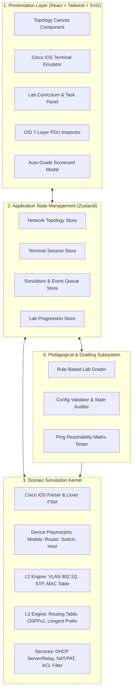
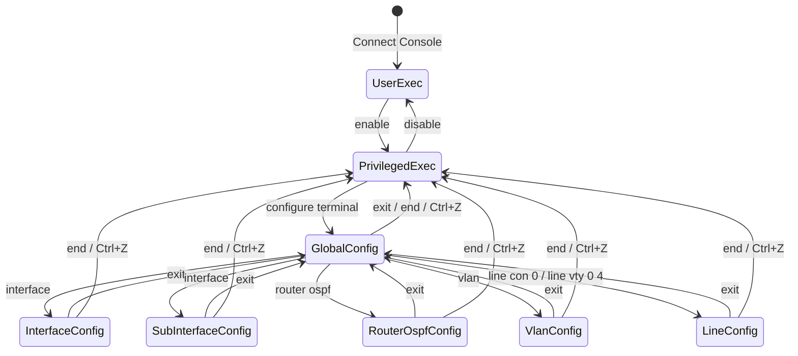
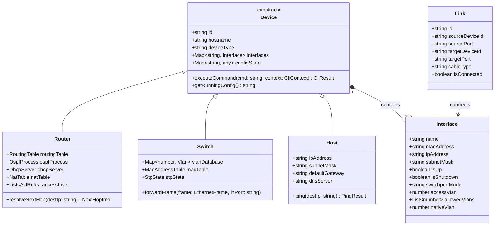
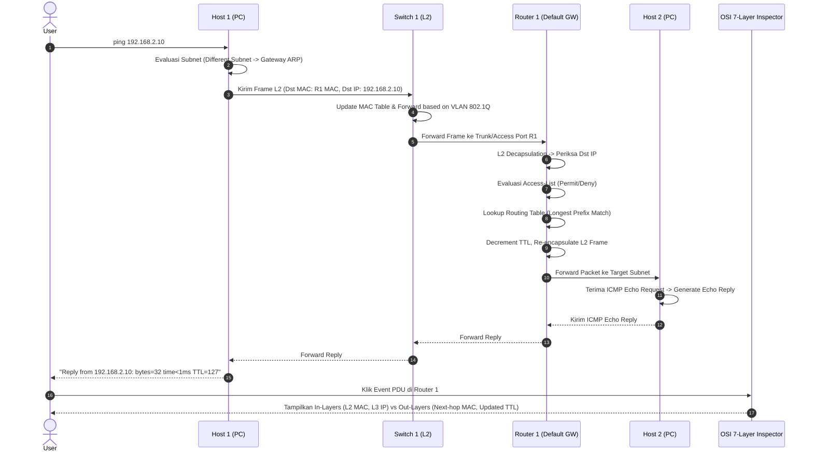
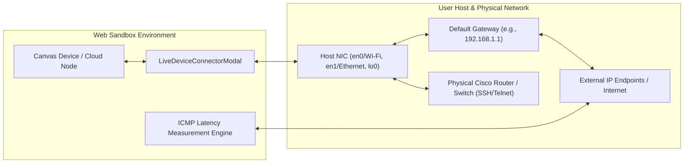
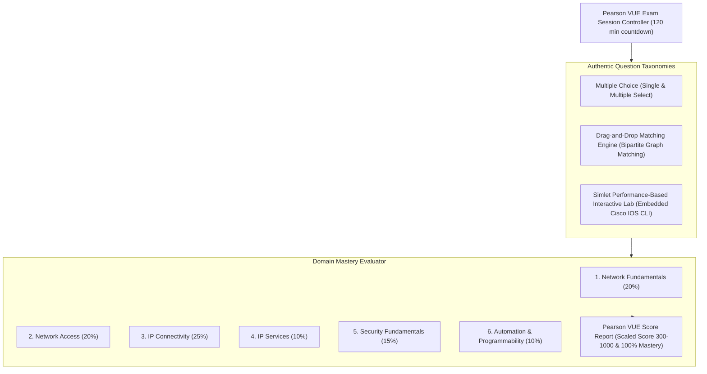

# DOKUMEN PERANCANGAN SISTEM (SOFTWARE DESIGN DOCUMENT - SDD)
## Berdasarkan Standar IEEE Std 1016-2009
### Proyek: CCNA NetSim Pro - Cisco Network Simulator & Auto-Grader

---

## 1. Ikhtisar Arsitektur Sistem (System Architectural Overview)

Sistem **CCNA NetSim Pro** dirancang menggunakan arsitektur berlapis (*Layered & Component-Based Architecture*) yang memisahkan secara tegas antara lapisan antarmuka pengguna (*Presentation*), logika eksekusi perintah (*CLI Engine*), kernel protokol simulasi (*Network Kernel*), dan modul asesmen laboratorium (*Auto-Grading Engine*).

---

## 2. Dekomposisi Subsistem & Komponen

### 2.1 Subsistem Cisco IOS CLI & Finite State Machine (FSM)
Parser CLI Cisco mengimplementasikan mesin keadaan berhingga (*Finite State Machine*) untuk mengelola navigasi hierarki mode eksekusi perintah Cisco IOS secara ketat:

Tabel Transisi Keadaan Prompt:
| Mode CLI | Tampilan Prompt | Perintah Masuk Utama | Perintah Keluar |
| :--- | :--- | :--- | :--- |
| **User EXEC** | `Router>` | Inisialisasi sesi | `exit` (disconnect) |
| **Privileged EXEC** | `Router#` | `enable` | `disable`, `exit` |
| **Global Config** | `Router(config)#` | `configure terminal` | `exit`, `end` |
| **Interface Config** | `Router(config-if)#` | `interface GigabitEthernet0/0` | `exit`, `end` |
| **Sub-Interface Config**| `Router(config-subif)#`| `interface GigabitEthernet0/0.10` | `exit`, `end` |
| **VLAN Config** | `Router(config-vlan)#` | `vlan 10` | `exit`, `end` |
| **Router OSPF Config** | `Router(config-router)#`| `router ospf 1` | `exit`, `end` |
| **Line Config** | `Router(config-line)#` | `line console 0` | `exit`, `end` |

---

## 3. Diagram Kelas Sistem (UML Class Diagram)

---

## 4. Diagram Sekuens Alur Paket & Inspeksi OSI (Sequence Diagram)

Diagram berikut mengilustrasikan alur pemrosesan transmisi paket ICMP Echo (Ping) dari Host1 melalui Switch1 dan Router1 ke Host2 dalam mode simulasi:

---

## 5. Subsistem Penilaian Otomatis (Lab Auto-Grader Architecture)

Mesin penilaian otomatis (*Lab Auto-Grader*) bekerja secara deterministik melalui metode audit berjenjang:
1. **Pemeriksaan Deklaratif (Running-Config AST Inspection)**: Memverifikasi keberadaan sintaks wajib (misal: `ip address`, `encapsulation dot1Q`, `switchport mode trunk`, `router ospf 1`).
2. **Pemeriksaan Keadaan Operasional (Operational State Verification)**: Memeriksa apakah status antarmuka bernilai `up/up`, apakah tabel rute memiliki rute yang diharapkan, dan apakah neighbor OSPF berstatus `FULL`.
3. **Pemeriksaan Verifikasi Fungsional (Data Plane Ping Matrix)**: Menguji konektivitas aktual dengan mengirimkan virtual ping antar node yang ditargetkan dalam skenario lab.
4. **Aturan Evaluasi Kelulusan Ketat (*Strict 100% Mastery Rule*)**: Mengikuti prinsip pedagogis *mastery learning*, kandidat hanya dinyatakan *Passed* jika dan hanya jika seluruh tugas lab terpenuhi secara sempurna tanpa kegagalan (`score === 100%`).

---

## 6. Arsitektur Live Physical Device Connector & Host NIC Bridge

Subsistem ini menjembatani lingkungan simulasi berbasis peramban (*browser sandbox*) dengan infrastruktur jaringan fisik nyata pada komputer host pengguna:

Tiga Modus Operasional:
1. **Host NIC Bridging**: Menautkan node awan (*Cloud Bridge*) ke antarmuka fisik lokal (seperti `en0`, `en1`, atau `lo0`) dan mengidentifikasi default gateway komputer host secara otomatis.
2. **Direct Hardware Connection**: Membuka sesi interaktif via SSH (port 22), Telnet (port 23), atau Cisco RESTCONF/NX-API (port 443) ke perangkat keras Cisco fisik dengan autentikasi kredensial dan logging riwayat perintah.
3. **Real-Time ICMP Ping Tester**: Melakukan pengujian latensi transmisi paket (RTT dalam milidetik) dan time-to-live (TTL) secara langsung ke IP target di jaringan fisik.

---

## 7. Arsitektur Pearson VUE Authentic Exam Engine

Subsistem ujian meniru persis arsitektur perangkat lunak pengujian sertifikasi resmi Pearson VUE untuk ujian Cisco CCNA 200-301 (v1.1):

1. **Drag-and-Drop Bipartite Matching**: Kandidat memetakan kumpulan item sumber (*draggable concepts*) ke slot target (*drop zones*). Validasi jawaban dinilai menggunakan verifikasi pencocokan pasangan terurut $(s_i, t_j)$.
2. **Simlet Interactive Lab Engine**: Kandidat diberikan skenario troubleshooting/konfigurasi performa nyata. Komponen memuat instansi virtual Router/Switch independen lengkap dengan sub-CLI parser dan mengevaluasi status perangkat (*live running state verification*).
3. **Pearson VUE Scaled Scoring**: Skor akhir ditransformasikan ke skala standar 300–1000 poin dengan rincian capaian persentase per domain kurikulum CCNA.
