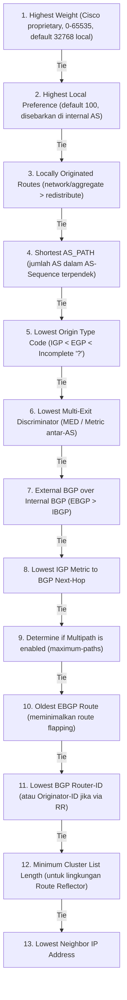
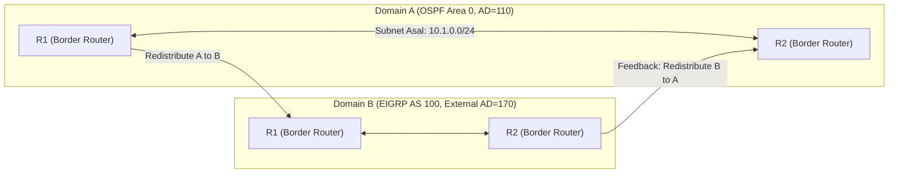

# FORMULASI MATEMATIKA & SPESIFIKASI ALGORITMA SISTEM
## Berdasarkan Standar IEEE & Analisis Teori Graf
### Proyek: Cisco NetSim Pro - Enterprise Multi-Tier Cisco Network Simulator & Auto-Grader
#### Cakupan: Cisco CCNA 200-301 (v1.1) & CCNP Enterprise v9 (ENCOR 350-401 v1.2 & ENARSI 300-410 v1.1)

---

Dokumen ini menyajikan model matematis formal, pembuktian teori graf, dan spesifikasi algoritma deterministik yang digunakan dalam kernel simulasi jaringan enterprise Cisco NetSim Pro untuk keperluan validasi ilmiah dan sitasi akademik (Disertasi Doktor / Publikasi IEEE Scopus Q1).

---

## 1. Pemodelan Alamat IPv4, Subnetting & Wildcard ACL

### 1.1 Representasi Ruang Alamat Biner
Ruang alamat IPv4 direpresentasikan sebagai bilangan bulat tidak bertanda 32-bit:
$$\text{IP} \in \mathbb{U}_{32} = [0, 2^{32}-1]$$

Konversi dari notasi desimal bertitik $D = (d_1, d_2, d_3, d_4)$ dengan $d_i \in [0, 255]$:
$$\text{IP}_{int} = (d_1 \ll 24) \lor (d_2 \ll 16) \lor (d_3 \ll 8) \lor d_4$$

### 1.2 Formulasi Subnet Mask, Network ID & Wildcard Mask
Untuk panjang prefix CIDR $p \in [0, 32]$:
$$M(p) = \begin{cases} 
0 & \text{jika } p = 0 \\
(\sim 0) \ll (32 - p) & \text{jika } 1 \le p \le 32 
\end{cases}$$

Alamat Jaringan $N$ dan Broadcast $B$:
$$N = \text{IP}_{int} \land M(p), \quad B = N \lor (\sim M(p))$$

Wildcard mask $W(p)$ untuk ACL dan pernyataan network Cisco:
$$W(p) = \sim M(p) = 255.255.255.255 - M(p)$$
Pengujian kecocokan paket $P$ terhadap aturan ACL $(N_{acl}, W_{acl})$:
$$\text{Match}(P, N_{acl}, W_{acl}) \iff (P \land \sim W_{acl}) == (N_{acl} \land \sim W_{acl})$$

---

## 2. Hirarki Evaluasi Rute (Longest Prefix Match & Administrative Distance)

Diberikan tabel perutean $\mathcal{R}$ yang terdiri dari himpunan rute $r_i = (N_i, M_i, \text{AD}_i, \text{Metric}_i, \text{NextHop}_i)$. Untuk paket dengan alamat IP tujuan $D$:
$$\mathcal{C}(D) = \{ r_i \in \mathcal{R} \mid (D \land M_i) = N_i \}$$

Rute optimal $r^*$ dipilih melalui aturan leksikografis deterministik:
1. **Longest Prefix Match (Panjang Prefix $p$ Terbesar)**:
   $$\mathcal{C}_{max} = \arg\max_{r_i \in \mathcal{C}(D)} \text{popcount}(M_i)$$
2. **Lowest Administrative Distance (AD)** jika prefix length sama:
   $$\mathcal{C}_{AD} = \arg\min_{r_i \in \mathcal{C}_{max}} \text{AD}_i$$
3. **Lowest Protocol Metric** jika AD sama:
   $$r^* = \arg\min_{r_i \in \mathcal{C}_{AD}} \text{Metric}_i$$

Matriks Nilai Administrative Distance Bawaan Cisco Enterprise:
| Protokol / Sumber Rute | Nilai AD Default |
| :--- | :---: |
| Connected Interface | **0** |
| Static Route | **1** |
| EIGRP Summary Route | **5** |
| External BGP (EBGP) | **20** |
| EIGRP Internal | **90** |
| OSPF (Intra, Inter, External) | **110** |
| IS-IS | **115** |
| RIPv2 | **120** |
| EIGRP External (Redistributed) | **170** |
| Internal BGP (IBGP) | **200** |

---

## 3. Algoritma Perhitungan Jalur Terpendek OSPF Multi-Area (Dijkstra SPF)

Topologi OSPF dimodelkan sebagai graf berarah terbobot $G = (V, E, w)$. Cost antarmuka $w(u, v)$ dihitung berdasarkan *Reference Bandwidth* $B_{ref}$ (default: $10^8$ bps):
$$w(u, v) = \left\lfloor \frac{B_{ref}}{\text{Bandwidth}(u, v)} \right\rfloor$$

### 3.1 Hirarki Preferensi Jalur OSPF RFC 2328
Jika terdapat beberapa jalur menuju subnet tujuan yang sama dari area berbeda, OSPF memilih rute berdasarkan hirarki tipe rute yang ketat, **bukan** berdasarkan nilai cost numerik terendah:
$$\text{Intra-Area (O)} \succ \text{Inter-Area (O IA)} \succ \text{External Type 1 (O E1 / N1)} \succ \text{External Type 2 (O E2 / N2)}$$

### 3.2 Formulasi Cost Rute Eksternal
- **Tipe E1 (External Metric 1)**: Cost total mencakup cost internal menuju ASBR ditambah cost eksternal yang diiklankan:
  $$\text{Cost}_{E1} = \text{Cost}_{\text{Internal-to-ASBR}} + \text{Cost}_{\text{Advertised}}$$
- **Tipe E2 (External Metric 2 - Default)**: Hanya memperhitungkan cost eksternal yang diiklankan oleh ASBR, cost internal hanya digunakan sebagai *tie-breaker*:
  $$\text{Cost}_{E2} = \text{Cost}_{\text{Advertised}}$$

---

## 4. Algoritma DUAL EIGRP & Formulasi Metrik Komposit (RFC 7868)

### 4.1 Formulasi Metrik Komposit EIGRP Klasik (Classic Metric)
Metrik komposit EIGRP menggabungkan bandwidth minimum dan total delay:
$$\text{Metric} = 256 \times \left( K_1 \cdot \text{BW}_{\min} + \frac{K_2 \cdot \text{BW}_{\min}}{256 - \text{Load}} + K_3 \cdot \text{Delay}_{\text{sum}} \right) \times \left( \frac{K_5}{\text{Reliability} + K_4} \right)$$

Dengan nilai konstanta bawaan Cisco $K_1 = 1, K_2 = 0, K_3 = 1, K_4 = 0, K_5 = 0$:
$$\text{Metric} = 256 \times \left( \text{BW}_{\min} + \text{Delay}_{\text{sum}} \right)$$

Di mana:
$$\text{BW}_{\min} = \frac{10^7}{\min_{l \in \text{path}} (\text{Bandwidth}(l) \text{ in kbps})}$$
$$\text{Delay}_{\text{sum}} = \frac{\sum_{l \in \text{path}} \text{Delay}(l) \text{ in tens of }\mu\text{s}}{10}$$

### 4.2 Formulasi Wide Metrics EIGRP Named Mode (Skala 64-Bit)
Untuk mendukung link berkecepatan tinggi ($\ge 10\text{ Gbps}$), Cisco IOS-XE Named Mode menggunakan konstanta pengali $65536$ dan delay dalam skala pikodetik ($10^{-12}$ detik):
$$\text{WideMetric} = \left( K_1 \cdot \frac{10^7 \times 65536}{\text{Bandwidth}_{\min}} + K_3 \cdot \frac{\text{Delay}_{\text{sum\_pico}} \times 65536}{10^6} \right)$$

### 4.3 Kondisi Kelayakan DUAL (DUAL Feasibility Condition)
Diberikan router lokal $R$, sebuah subnet tujuan $D$, dan tetangga $N$:
- **Feasible Distance ($FD$)**: Nilai metrik terbaik terhitung dari router lokal $R$ menuju tujuan $D$ sejak perubahan topologi terakhir.
- **Reported Distance ($RD$)** atau *Advertised Distance*: Nilai metrik dari tetangga $N$ menuju tujuan $D$.

```
Kondisi Kelayakan (Feasibility Condition - FC):
Tetangga N memenuhi syarat menjadi Feasible Successor (FS) jika dan hanya jika:
                      RD_N < FD_current
```

**Pembuktian Matematis Bebas-Loop (*Loop-Freedom Guarantee*)**:
Jika $RD_N < FD_{current}$, maka jalur dari $N$ menuju $D$ tidak mungkin melewati router lokal $R$, karena jika jalur tersebut melewati $R$, maka $RD_N$ harus lebih besar dari $FD_{current}$ ($RD_N \ge FD_{current} + \text{Cost}(N, R) > FD_{current}$), yang merupakan sebuah kontradiksi. Dengan demikian, kondisi kelayakan secara matematis menjamin *loop-free alternate path* seketika tanpa memerlukan siklus pertukaran pesan global.

### 4.4 Beban Tak Seimbang (*Unequal-Cost Load Balancing*)
Sebuah Feasible Successor $FS_k$ dapat dimasukkan ke dalam tabel routing untuk membagi beban trafik (*unequal-cost multipath*) jika memenuhi ambang batas *Variance* $V \ge 1$:
$$\text{Metric}(FS_k) \le V \times FD_{current}$$

---

## 5. Algoritma Penentuan Jalur Terbaik BGP-4 (13-Step Best Path Decision Tree)

Ketika router BGP menerima beberapa pengumuman rute NLRI menuju prefix tujuan yang sama, router mengevaluasi kandidat rute melalui algoritma pohon keputusan deterministik 13 langkah:



Rumusan fungsi keputusan:
$$\text{BestPath} = \arg\max_{r \in \mathcal{B}(P)} \left( \text{Weight}(r), \text{LocalPref}(r), \text{LocalOrig}(r), -\text{Len}(\text{AS\_Path}(r)), -\text{OriginCode}(r), -\text{MED}(r), \text{IsEBGP}(r), -\text{Cost}_{\text{IGP}}(r), -\text{BGP\_RID}(r), -\text{NeighborIP}(r) \right)$$

---

## 6. Analisis Graf Pencegahan Loop Redistribusi Rute (Mutual Redistribution)

Pada skenario redistribusi timbal-balik dua titik (*two-point mutual redistribution*) antara Domain $A$ (misal OSPF) dan Domain $B$ (misal EIGRP) melalui Boundary Router $R_1$ dan $R_2$, topologi membentuk graf siklik $C = (R_1, \text{Domain}_B, R_2, \text{Domain}_A)$:



### 6.1 Teorema Pembentukan Loop Umpan Balik (*Routing Feedback Loop*)
Jika rute $P$ dari Domain $A$ diredistribusikan ke Domain $B$ oleh $R_1$, rute tersebut muncul di $R_2$ dari arah Domain $B$. Jika $R_2$ meredistribusikan kembali rute tersebut ke Domain $A$ dengan metrik lebih menarik daripada jalur internal asli, terbentuk siklus perutean (*routing loop*) atau rute sub-optimal (*sub-optimal routing*).

### 6.2 Solusi Matematis Pemutusan Siklus: Route Tagging ($\tau$) & Route-Maps
Untuk mencegah siklus, setiap rute yang diredistribusikan ditandai dengan nilai integer tag $\tau \in [1, 2^{32}-1]$ menggunakan Route-Map:
1. **Aturan Injeksi pada $R_1$**:
   $$\text{Redistribute}(A \to B): \quad \text{SetTag}(P) = \tau_A$$
2. **Aturan Filter pada $R_2$**:
   $$\text{Redistribute}(B \to A): \quad \text{If } \text{GetTag}(P) == \tau_A \implies \text{DROP} \quad (\text{Deny})$$
   $$\text{SetTag}(P) = \tau_B$$

Dengan menerapkan predikat filter berbasis tag:
$$\forall r \in \text{Routes}(B), \quad \text{Redistribute}(r) \iff \text{Tag}(r) \ne \tau_A$$
maka siklus pada graf perutean terputus secara formal, menjamin konvergensi topologi bebas loop.

---

## 7. Model Matematika Protokol Redundansi Gateway (FHRP: HSRP & VRRP)

Pada kelompok redundansi FHRP dengan anggota himpunan router $R_{grp} = \{r_1, r_2, \dots, r_k\}$, pemilihan *Active/Master Router* $r^*$ dimodelkan sebagai fungsi optimasi terurut:
$$r^* = \arg\max_{r_i \in R_{grp}} \left( \text{Priority}(r_i), \text{IP}_{int}(r_i) \right)$$

### 7.1 Algoritma Penentuan Virtual MAC Address
Untuk memfasilitasi penerusan Layer 2 tanpa mengubah konfigurasi gateway pada host, simulator secara deterministik membangkitkan alamat MAC virtual berdasarkan nomor grup $g$:
- **HSRP Versi 1 ($g \in [0, 255]$)**:
  $$\text{MAC}_{HSRPv1} = \text{00:00:0c:07:ac:} \, \text{hex}_2(g)$$
- **HSRP Versi 2 ($g \in [0, 4095]$)**:
  $$\text{MAC}_{HSRPv2} = \text{00:00:0c:9f:f} \, \text{hex}_3(g)$$
- **VRRP Versi 2/3 ($g \in [1, 255]$)**:
  $$\text{MAC}_{VRRP} = \text{00:00:5e:00:01:} \, \text{hex}_2(g)$$

---

## 8. Semantik Evaluasi Policy-Based Routing (PBR) & IP SLA

Untuk paket masuk $P$ pada antarmuka yang menerapkan kebijakan $\text{PBR} = \{ (c_1, a_1), (c_2, a_2), \dots, (c_m, a_m) \}$ di mana setiap aturan ke-$j$ terdiri dari klausa pencocokan $c_j$ (ACL) dan aksi $a_j$ (`set ip next-hop` $N_j$ dengan tracking IP SLA $T_j$):

$$\text{ForwardAction}(P) = \begin{cases}
\text{DirectForward}(N_j) & \text{jika } \exists j \le m \text{ s.t. } \text{Match}(P, c_j) \land \text{SlaStatus}(T_j) == \text{UP} \\
\text{FIB\_Lookup}(P) & \text{jika tidak ada aturan cocok atau seluruh probe SLA Down}
\end{cases}$$

Model ini menjamin pengalihan jalur yang deterministik dan tahan terhadap kegagalan link (*dynamic failover*).

---

## 9. Formulasi Matematika & Teori Graf Multi-Tenant Virtualization (VRF-Lite) dan MPLS Forwarding (LFIB)

### 9.1 Partisi Ruang Alamat dan Tabel Perutean (VRF-Lite)
Pada router fisik $R$, himpunan antarmuka dinotasikan dengan $\mathcal{I}(R)$. Virtual Routing and Forwarding (VRF) mempartisi $\mathcal{I}(R)$ menjadi sub-himpunan saling lepas (*disjoint sets*):
$$\mathcal{I}(R) = \mathcal{I}_{global} \cup \bigcup_{k=1}^{n} \mathcal{I}_{V_k}, \quad \text{di mana } \mathcal{I}_{V_j} \cap \mathcal{I}_{V_k} = \emptyset \quad (\forall j \ne k)$$

Setiap instans VRF $V_k$ didefinisikan secara formal sebagai tupel:
$$V_k = \langle \text{Name}_k, \text{RD}_k, \mathcal{RT}^{imp}_k, \mathcal{RT}^{exp}_k, \mathcal{T}_k, \mathcal{A}_k \rangle$$
di mana:
- $\text{RD}_k \in \mathbb{N} : \mathbb{N}$ adalah *Route Distinguisher* yang membuat prefix global menjadi unik ($\text{VPN-IPv4} = \text{RD} \times \text{IPv4}$).
- $\mathcal{RT}^{imp}_k, \mathcal{RT}^{exp}_k \subset \text{BGP Extended Communities}$ adalah *Route Targets* untuk impor dan ekspor kebijakan rute.
- $\mathcal{T}_k$ adalah *Routing Information Base* (RIB) terisolasi untuk penyewa $k$.
- $\mathcal{A}_k$ adalah *ARP Table* independen untuk memetakan IP-ke-MAC dalam domain broadcast penyewa $k$.

#### Teorema Resolusi Alamat Bertumpuk (Overlapping Subnets)
Untuk sebarang prefix jaringan identik $P = \text{IP}/\mu$ yang dikonfigurasi pada dua antarmuka berbeda $i_1 \in \mathcal{I}_{V_1}$ dan $i_2 \in \mathcal{I}_{V_2}$:
$$\text{LPM}(P, \mathcal{T}_{V_1}) \ne \text{LPM}(P, \mathcal{T}_{V_2})$$
Simulator mengevaluasi tabel penerusan berdasarkan konteks antarmuka masuk $i_{in}$:
$$\text{FIB\_Lookup}(d, i_{in}) = \begin{cases}
\text{LPM}(d, \mathcal{T}_{V_k}) & \text{jika } i_{in} \in \mathcal{I}_{V_k} \\
\text{LPM}(d, \mathcal{T}_{global}) & \text{jika } i_{in} \in \mathcal{I}_{global}
\end{cases}$$
sehingga tidak terjadi tabrakan rute (*route collision*) antar pelanggan multi-tenant.

### 9.2 Distribusi Label MPLS dan Tabel LFIB (Label Forwarding Information Base)
Pada jaringan bertransit MPLS, graf topologi direpresentasikan sebagai $G = (V_{LSR}, E_{MPLS})$. Setiap *Label Switching Router* $R_m \in V_{LSR}$ mengalokasikan label lokal $L_{in}(P) \in [16, 2^{20}-1]$ untuk setiap prefix tujuan $P \in \mathcal{T}$.

Melalui sesi peering LDP (*Label Distribution Protocol*), router $R_m$ mempertukarkan label dengan tetangganya $R_n \in \text{Adj}(R_m)$. Entri LFIB dipetakan sebagai fungsi transisi keadaan label:
$$\text{LFIB}(L_{in}(P)) = \langle \text{OutInterface}, \text{NextHop}, \text{Operation}(L_{out}) \rangle$$
di mana operasi penerusan ditentukan oleh:
$$\text{Operation}(L_{out}) = \begin{cases}
\text{Swap}(L_{out}(P, R_n)) & \text{jika } R_n \text{ adalah transit LSR non-egress} \\
\text{Pop} \quad (\text{PHP / Implicit Null}) & \text{jika } R_n \text{ adalah Penultimate Hop} \\
\text{Untagged} & \text{jika tujuan terhubung langsung (egress node)}
\end{cases}$$
Formulasi ini memastikan penerusan paket berkecepatan tinggi berbasis label tanpa memerlukan rekursi rute IP pada inti jaringan (*core MPLS*).
