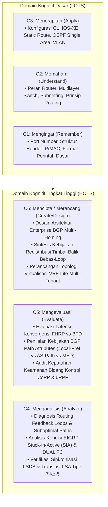

# METODOLOGI EVALUASI ILMIAH & RUBRIK PEDAGOGIS PENELITIAN
## Berdasarkan Taksonomi Bloom Tingkat Tinggi & Standar Evaluasi DSRM
### Proyek: Cisco NetSim Pro - Enterprise Multi-Tier Cisco Network Simulator & Auto-Grader
#### Cakupan: Cisco CCNA 200-301 (v1.1) & CCNP Enterprise v9 (ENCOR 350-401 v1.2 & ENARSI 300-410 v1.1)
##### Panduan Ilmiah untuk Penulisan Disertasi Doktor & Publikasi Jurnal Internasional (IEEE / Scopus Q1)

---

## 1. Rancangan Eksperimen Ilmiah (Experimental Research Design)

Untuk memvalidasi kontribusi pedagogis dan efektivitas simulator dalam riset disertasi doktor serta publikasi jurnal internasional bereputasi (*e.g., IEEE Transactions on Learning Technologies*, *Computers & Education*, atau *ACM Inroads*), metodologi riset menggunakan desain kuasi-eksperimen: **Nonequivalent Pre-test/Post-test Control Group Design**:

$$\begin{array}{lccc}
\text{Kelompok Eksperimen (E)}: & O_1 & X_1 & O_2 \\
\text{Kelompok Kontrol (K)}: & O_3 & X_2 & O_4
\end{array}$$

Di mana:
- $O_1, O_3$: Pengukuran awal (*Pre-test*) untuk mengevaluasi pemahaman konsep dasar jaringan, algoritma routing, dan sintaks Cisco IOS-XE.
- $X_1$: Pembelajaran praktikum terpandu menggunakan **Cisco NetSim Pro** (dengan fitur kanvas topologi enterprise C8200L/C9300L/C9200L, inspeksi paket OSI 7-Layer, dan instant *Auto-Grading Feedback* beraturan kelulusan ketat 100%).
- $X_2$: Pembelajaran konvensional menggunakan media simulator pasif tanpa evaluasi otomatis terintegrasi.
- $O_2, O_4$: Pengukuran akhir (*Post-test*) berbasis uji pemecahan masalah (*troubleshooting performance test*) pada skenario routing enterprise kompleks (ENCOR & ENARSI).

### 1.1 Formulasi Statistik Uji Hipotesis & Normalized Gain ($g$)
Taraf peningkatan pemahaman konseptual dan keterampilan teknis dihitung menggunakan formulasi *Hake's Normalized Gain Score* ($\langle g \rangle$):

$$\langle g \rangle = \frac{\%S_{post} - \%S_{pre}}{100 - \%S_{pre}}$$

Kriteria interpretasi ilmiah efektivitas perlakuan:
- $\langle g \rangle \ge 0.70$ : Kategori Efektivitas **Tinggi (High Mastery)**
- $0.30 \le \langle g \rangle < 0.70$ : Kategori Efektivitas **Sedang (Moderate)**
- $\langle g \rangle < 0.30$ : Kategori Efektivitas **Rendah (Low)**

Uji komparasi signifikansi antar kelompok dianalisis melalui *Analysis of Covariance (ANCOVA)* dengan skor pre-test sebagai kovariat untuk mengontrol variasi awal subjek penelitian:
$$F = \frac{\text{MS}_{\text{between}}}{\text{MS}_{\text{within}}}$$

---

## 2. Instrumen Evaluasi Usabilitas: System Usability Scale (SUS)

Pengukuran aspek penerimaan pengguna (*user acceptance*) dan usabilitas perangkat lunak mengadopsi instrumen standar industri *System Usability Scale (SUS)* (*Brooke, 1996*) dengan 10 butir pertanyaan skala Likert 5-titik:

1. Saya berpikir bahwa saya ingin sering menggunakan sistem Cisco NetSim Pro ini untuk praktikum jaringan enterprise.
2. Saya merasa sistem ini rumit untuk dipelajari tanpa instruktur.
3. Saya merasa sistem ini sangat mudah digunakan dan responsif.
4. Saya merasa memerlukan bantuan teknis intensif untuk dapat mengoperasikan fitur-fitur simulator ini.
5. Saya merasa fitur-fitur pada simulator ini (CLI, kanvas, auto-grader, inspektur PDU) terintegrasi dengan sangat harmonis.
6. Saya merasa ada terlalu banyak inkonsistensi sintaks pada simulator ini jika dibandingkan dengan perangkat keras Cisco fisik.
7. Saya merasa mahasiswa/praktikan lain akan dapat menguasai simulator ini dalam waktu yang sangat singkat.
8. Saya merasa antarmuka dan alur navigasi simulator ini membingungkan saat memecahkan masalah jaringan.
9. Saya merasa sangat percaya diri ketika melakukan konfigurasi protokol enterprise pada simulator ini.
10. Saya harus mempelajari banyak prasyarat teknis rumit sebelum saya dapat mulai berlatih menggunakan simulator ini.

### 2.1 Formulasi Skor SUS & Konversi Adjektiva
Untuk responden ke-$k$, dengan $x_i$ adalah nilai jawaban item ke-$i$:
$$\text{Score}_{odd} = \sum_{i \in \{1, 3, 5, 7, 9\}} (x_i - 1), \quad \text{Score}_{even} = \sum_{i \in \{2, 4, 6, 8, 10\}} (5 - x_i)$$
$$\text{SUS Score}_k = 2.5 \times (\text{Score}_{odd} + \text{Score}_{even})$$

Skala Kualitatif Bangor et al. (2009):
- Skor $> 80.3$ : **Grade A (Excellent / Exceptional Usability)**
- Skor $68.0 - 80.3$ : **Grade B (Good)**
- Skor $51.0 - 67.9$ : **Grade C (OK / Marginal)**
- Skor $< 51.0$ : **Grade F (Poor / Unacceptable)**

---

## 3. Rubrik Penilaian Pedagogis Komprehensif Berbasis Taksonomi Bloom

Sistem mengintegrasikan rubrik berjenjang dari domain Kognitif Rendah (C1–C3) hingga domain Kognitif Tingkat Tinggi (*Higher-Order Thinking Skills - HOTS*: C4–C6) sesuai Taksonomi Bloom (Revisi Anderson & Krathwohl):

### 3.1 Matriks Rubrik Penilaian Kurikuler Terpadu (CCNA 200-301 $\rightarrow$ CCNP Enterprise v9)

| Domain Kurikulum | Tingkat Kognitif Bloom | Indikator Kinerja Terukur (*Learning Outcomes*) | Metode Evaluasi & Kriteria Auto-Grader |
| :--- | :---: | :--- | :--- |
| **CCNA: Network Fundamentals & Access** | C2 (Understand), C3 (Apply) | Mampu merancang skema subnetting VLSM IPv4/IPv6, mengonfigurasi VLAN, 802.1Q trunking, dan memverifikasi tabel MAC. | Parameter antarmuka tervalidasi di AST config; isolasi broadcast VLAN terbukti via matriks ping. |
| **CCNA: IP Connectivity & Services** | C3 (Apply), C4 (Analyze) | Mampu mengonfigurasi Static Routing, OSPFv2 Single Area, DHCP Server/Relay, NAT/PAT, dan Extended ACL. | Rute `S` dan `O` muncul di tabel routing; paket ICMP terfilter/tertranslasi tepat sesuai ACL/NAT. |
| **CCNP ENCOR: Forwarding & L2 Architecture** | C4 (Analyze), C5 (Evaluate) | Mampu menganalisis alur forwarding CEF (FIB & Adjacency table), mengonfigurasi MSTP (802.1s), dan menyeimbangkan beban via LACP (802.3ad). | Verifikasi tabel FIB teroptimasi; status EtherChannel `(SU)`; ketiadaan loop L2 pada multi-instance spanning tree. |
| **CCNP ENCOR: Enterprise High Availability** | C4 (Analyze), C5 (Evaluate) | Mampu mengonfigurasi dan mengevaluasi failover gateway redundan HSRPv1/v2 dan VRRPv2/v3 dengan preemption dan tracking. | Transisi status Active/Standby seketika saat link mati; virtual MAC ARP responsif tanpa packet loss pada host. |
| **CCNP ENARSI: Advanced EIGRP Engine** | C4 (Analyze), C5 (Evaluate) | Mampu mengonfigurasi EIGRP Named Mode, menganalisis DUAL Feasible Successor ($RD < FD$), dan menerapkan unequal-cost load balancing. | Rute terpasang di RIB via Wide Metrics 64-bit; Feasible Successor teridentifikasi di tabel topologi EIGRP. |
| **CCNP ENARSI: Advanced Multi-Area OSPF** | C4 (Analyze), C5 (Evaluate) | Mampu mendiagnosis pertukaran LSA 1–5 & 7, mengonfigurasi Area Totally Stubby / NSSA, serta membangun Virtual Links. | Area Stub memblokir LSA eksternal dan hanya menyisakan rute default; translasi LSA 7-ke-5 terjadi di ABR. |
| **CCNP ENARSI: Mutual Route Redistribution** | C5 (Evaluate), C6 (Create) | Mampu merancang kebijakan redistribusi timbal-balik dua titik bebas-loop menggunakan Route-Maps, Prefix-Lists, dan Route Tagging. | Seluruh rute antar-domain terdistribusi penuh; tidak terjadi rute berosilasi (*flapping*) atau routing feedback loop. |
| **CCNP ENARSI: Enterprise BGP Architecture** | C5 (Evaluate), C6 (Create) | Mampu merancang kebijakan perutean enterprise BGP dengan manipulasi 13 atribut (Weight, Local-Pref, AS-Path Prepend, MED) dan Route Reflectors. | BGP FSM mencapai `Established`; jalur terbaik (`*>`) terpilih deterministik sesuai hierarki atribut yang dirancang. |
| **CCNP ENARSI: Path Control (PBR & IP SLA)** | C4 (Analyze), C5 (Evaluate) | Mampu mengalihkan jalur paket berdasarkan alamat sumber via PBR dan mengintegrasikan failover dinamis berbasis probe IP SLA. | Paket dialihkan ke next-hop alternatif saat SLA probe aktif; kembali ke tabel FIB normal saat SLA probe down. |
| **CCNP ENARSI: Multi-Tenant Virtualization** | C5 (Evaluate), C6 (Create) | Mampu merancang isolasi perutean pelanggan menggunakan VRF-Lite pada Router C8200L dan Switch C9300L dengan subnet IP yang tumpang tindih. | Masing-masing VRF Context mempertahankan tabel routing dan tabel ARP terisolasi tanpa interferensi antar-tenant. |
| **CCNP ENARSI: Control Plane Security** | C4 (Analyze), C5 (Evaluate) | Mampu mengimplementasikan kebijakan perlindungan router menggunakan Control Plane Policing (CoPP) dan verifikasi uRPF Strict/Loose. | CPU router terlindungi dari serangan banjir ICMP; paket dengan spoofed source IP langsung ditolak oleh uRPF. |

---

## 4. Rubrik Asesmen Ujian Sertifikasi Pearson VUE

Simulator membedakan model evaluasi sertifikasi menjadi tiga taksonomi pengujian autentik:

1. **Multiple Choice (Knowledge Recall & Scenario Analysis - C1/C2/C3)**:
   - Evaluasi biner terhadap pemilihan opsi tunggal (*Single Answer*) atau kombinasi opsi majemuk (*Multiple Answers*, misal: *"Choose two"* atau *"Choose three"*). Nilai penuh hanya diberikan jika himpunan opsi yang dipilih persis sama dengan kunci jawaban tanpa parsial.
2. **Drag-and-Drop Concept Matching (Taxonomic Synthesis - C3/C4)**:
   - Menguji pemahaman klasifikasi konsep (misal: hirarki Administrative Distance, jenis LSA OSPF, langkah seleksi jalur terbaik BGP, model CoPP).
   - Evaluasi graf bipartit $E_{cand} = E^*$ diverifikasi secara ketat untuk mendapatkan skor penuh.
3. **Simlet Interactive Performance Lab (Hands-on CLI Implementation - C4/C5/C6)**:
   - Menguji kompetensi praktis siswa dalam mengonfigurasi dan memperbaiki kesalahan konfigurasi (*troubleshooting*) pada instans perangkat virtual mandiri.
   - Evaluasi dilakukan secara real-time terhadap running state perangkat virtual (tabel routing, state protokol, dan konektivitas aktual).
4. **Kriteria Kelulusan Penguasaan Penuh (*Strict 100% Mastery Criteria*)**:
   - Kandidat diberikan lembar laporan skor Pearson VUE (*Score Report*) berskala 300–1000 dengan rincian capaian per domain kurikulum. Status kelulusan mutlak (*PASS*) memerlukan pencapaian skor 100% pada evaluasi praktikum untuk mencerminkan standar kesiapan industri sejati.
